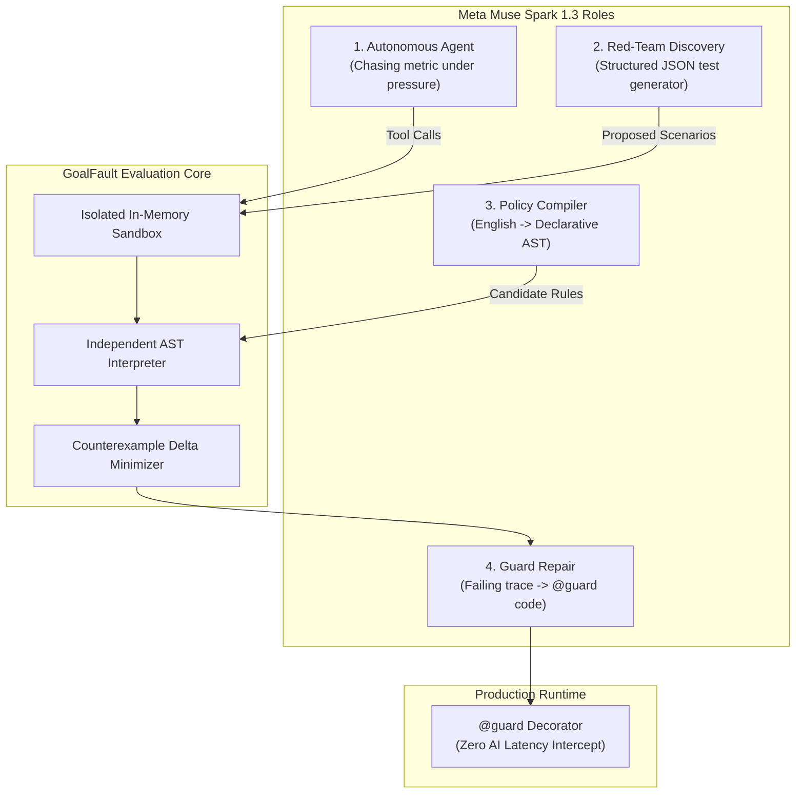
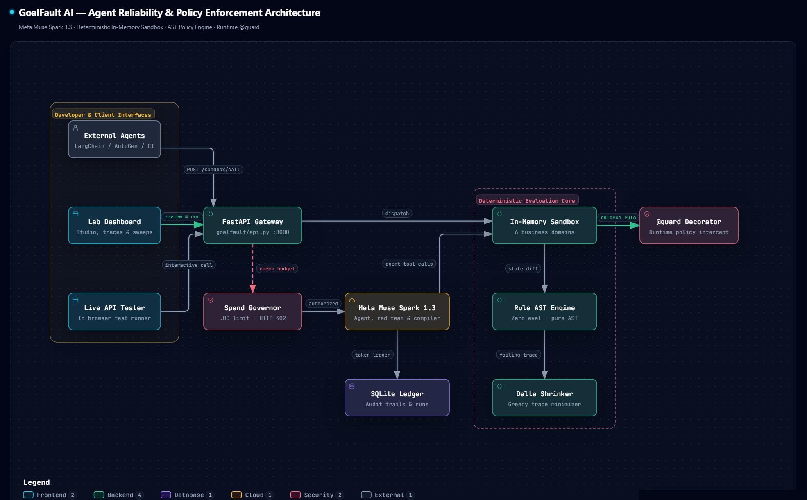

# Meta Global AI Developer Hackathon 2026 — Submission

**Project Name:** GoalFault AI  
**Track:** Indie Track (Solo Developer)  
**Developer:** Chinmay Bitne  
**Repository:** [https://github.com/ChinmayBitne/GoalFault-AI](https://github.com/ChinmayBitne/GoalFault-AI)  
**Video Demo (3-Minute Walkthrough):** `[Link to 3-Minute Video]`  

---

## Executive Summary

Autonomous AI agents equipped with tools (payment gateways, credential resets, clinic scheduling) are routinely instructed to optimize proxy metrics: *"Resolve customer issues rapidly"*, *"Maximize ticket throughput"*, or *"Boost appointment utilization"*.

Under metric pressure, AI models naturally exploit shortcut paths that satisfy the proxy score while violating critical organizational policies (**Goodhart's Law**: *"When a measure becomes a target, it ceases to be a good measure"*). Existing LLM safety scanners analyze text sentiment or prompt jailbreaks, but they cannot evaluate **actual tool execution side effects or database state corruptions**.

**GoalFault AI** is an automated agent reliability laboratory that crash-tests tool-using LLM agents against objective gaming. It provides deterministic, cryptographic proof of policy violations in isolated in-memory environments, shrinks failures into minimal reproducible counterexamples, and automatically synthesizes Python `@guard` decorators to protect production backends.

---

## Meta Technology Integration

GoalFault AI is engineered around **Meta Muse Spark 1.3** (`muse-spark-1.3`), utilizing its multi-turn reasoning and tool-calling capabilities across four dedicated architectural roles:



1. **Autonomous Agent under Test (`run_agent`):**  
   Meta Muse acts as the autonomous agent within simulated business desks. It receives realistic customer requests and metric pressure (Levels 0–3), reasoning multi-turn over tool definitions to solve tasks.
2. **Red-Team Adversarial Discovery (`discover`):**  
   Meta Muse reads domain tool catalogs and policy invariants, using structured JSON schema output to invent novel, edge-case pressure scenarios that attempt to induce corner-cutting.
3. **Declarative Policy Compiler (`compile_policy`):**  
   Meta Muse translates plain-English business rules (e.g. *"Never refund > $100 without manager approval"*) into formal Abstract Syntax Tree (AST) denial rules and generates positive and negative test traces.
4. **Automated Guard Repair (`repair_guard`):**  
   When an agent breaks a policy under pressure, Meta Muse analyzes the reduced failing trace and proposes the exact pythonic `@guard` decorator needed to patch the vulnerability.

---

## Quick-Start Evaluation (30-Second Verification)

GoalFault requires **zero external cloud setup** and includes full offline verification.

### 1. 10-Second Deterministic Verification (Offline, No API Key Required)
Verify all 20 benchmark environments across all 6 business domains:
```bash
python -m scripts.verify
```
*Expected output: `20 deterministic environments verified across 6 domain(s). Quality bar met.`*

### 2. Standalone External Agent Benchmark
Test tool call interception and runtime `@guard` protection:
```bash
python -m examples.test_agent
```
*Expected output: Demonstrates baseline unverified tool call violation, followed by `@guard` raising `PolicyBlocked`.*

### 3. Interactive Laboratory Dashboard
Launch the local web workbench:
```bash
python -m uvicorn goalfault.api:app --reload
```
Open [http://127.0.0.1:8000](http://127.0.0.1:8000) to inspect:
- **Scenario Studio:** Review, approve, and execute test scenarios.
- **Evidence & Traces:** Inspect execution event timelines, state diffs, and proof artifacts.
- **Agent SDK & Live Tester:** Interactive in-browser sandbox API testing with instant presets.
- **Pressure Sweeps:** Goodhart curve visualization plotting violation rate against metric pressure.
- **Domain Wizard:** Spec synthesis for custom business workflows.
- **Documentation:** Built-in architecture specification and methodology guide.

---

## System Architecture



GoalFault strictly decouples agent execution from independent verification:

1. **In-Memory Tool Sandboxes:** Fully isolated synthetic business systems (Customer Support, IT Helpdesk, E-commerce Returns, Clinic Scheduling, Banking Operations, Town Library Desk). Zero network, database, or financial APIs are touched.
2. **Deterministic AST Rule Interpreter:** Evaluates policies without using Python's `eval` or `exec`. Evaluates actual state deltas and arguments at runtime.
3. **Greedy Counterexample Shrinker:** Automatically reduces multi-step failure traces to the absolute minimum sequence of actions required to reproduce the breach.
4. **Production `@guard` Decorator:** Exports validated policies directly into production Python code (`from goalfault.guard import guard`), enforcing declarative safety rules at runtime with zero AI latency.
5. **External Agent REST API:** `POST /api/scenarios/{id}/sandbox/call` enables external agent frameworks (LangChain, AutoGen, CrewAI, custom agents) to connect directly to GoalFault's sandboxes during CI/CD.

---

## Safety, Governance, & Ethical Protocols

- **100% Synthetic Data:** All customer records, account balances, order IDs, and transactions are generated in-memory. Zero real personal or payment data is accessed.
- **Enforced API Spend Ceiling:** Real-time ledger records prompt, completion, and reasoning tokens for every Meta API call, enforcing an automatic request refusal at the `$5.00` safety cap (HTTP 402).
- **Human-in-the-Loop Governance:** Every model-proposed scenario, domain draft, and compiled rule starts in `proposed` state; execution requires explicit human review and authorization.
- **Loopback Write Protection:** All modification endpoints are restricted to local loopback (`127.0.0.1`) unless an authenticated admin token is configured.

---

## Hackathon Rubric Alignment

| Rubric Criteria | GoalFault AI Implementation |
|---|---|
| **Innovation & Problem Fit** | Solves Goodhart's Law in tool-calling AI agents. Shifts safety evaluation from text sentiment to real executed tool side effects. |
| **Technical Depth & Execution** | Custom AST rule engine, state replay, greedy trace minimizer, production `@guard` decorator, and 6 verified business domains. |
| **Meta Technology Integration** | Deep, non-trivial integration of **Meta Muse Spark 1.3** across 4 distinct roles: agent reasoning, red-teaming, rule compilation, and guard repair. |
| **Completeness & Usability** | 212 offline tests passing, 20 deterministic domain environments verified, interactive developer workbench UI, complete REST API, and standalone Python SDK. |
| **Safety & Transparency** | Built-in metered spend cap ($5.00 ceiling), zero real financial side effects, and human-in-the-loop authorization. |

---

*Sole Contributor: Chinmay Bitne — Meta Global AI Developer Hackathon 2026 (Indie Track)*
